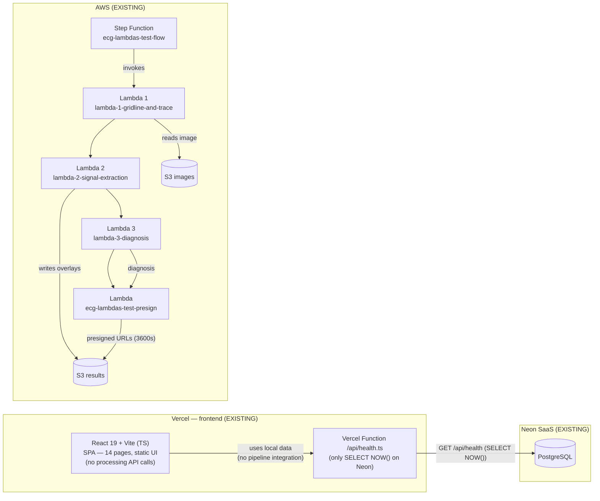
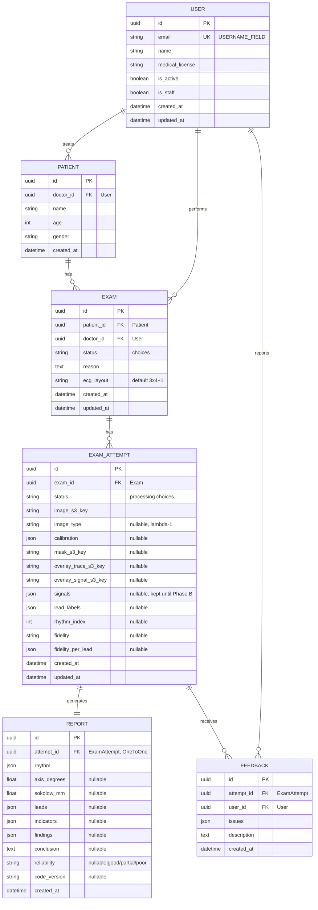
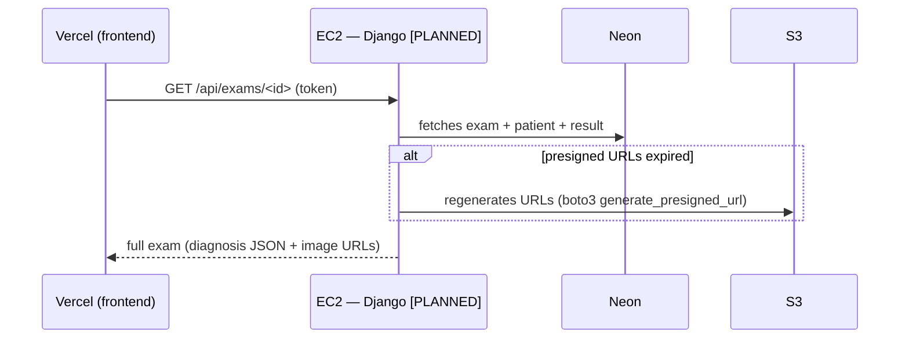
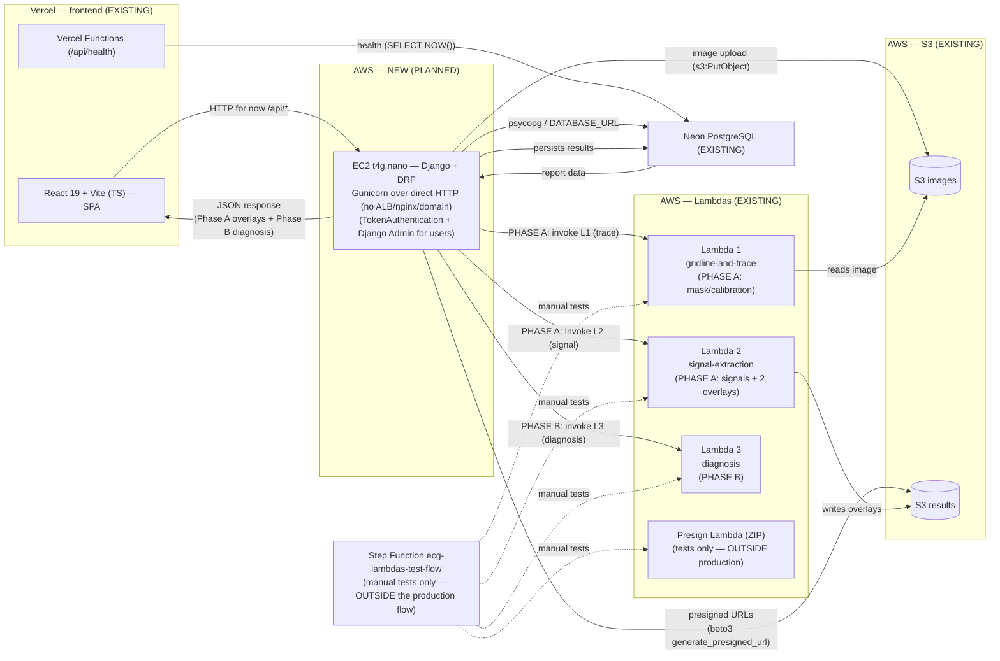

# ARCHITECTURE — ECG Project

Architecture document for the `ecg-project` ecosystem, with two views:

1. **Current Architecture**: what exists today (deployed/working).
2. **Target Architecture (Complete)**: the proposed plan (NOT implemented yet),
   adding a Django backend on EC2 as the API/orchestration layer.

> Historical document. It was based on the files of the original Lambda
> pipeline repo (`ecg-lambdas`, now retired) and on the frontend in this repo.
> Legacy field names of that pipeline are written here in English.
> Legend: **[EXISTING]** = already deployed · **[PLANNED]** = proposed, not implemented.

---

## 1. Current Architecture

### 1.1 Overview

Today there are **two independent halves**:

- **Frontend (this repo)**: React + Vite SPA in TypeScript, deployed on
  **Vercel**. It is a UI prototype: pages navigate between each other and show
  local/hardcoded data; **it does not call any processing API**. There is only
  one Vercel endpoint, `api/health.ts`, which runs `SELECT NOW()` on **Neon**
  using `@neondatabase/serverless`.
- **ecg-lambdas**: serverless ECG image processing pipeline on AWS:
  - 3 Lambdas in Docker containers (ECR): trace/grid extraction, signal
    extraction, diagnosis.
  - 1 ZIP Lambda that presigns S3 URLs (`ecg-lambdas-test-presign`).
  - 1 **Step Function** `ecg-lambdas-test-flow` orchestrating
    lambda1 → lambda2 → lambda3 → presign.
  - 2 S3 buckets (`images` and `results`) with versioning.
  - Dedicated IAM (one role per lambda + Step Function role). Terraform IaC
    with S3 backend `ecg-lambdas-terraform-state`.

**Postgres (Neon) already exists** and is outside AWS; it is not part of the
repos' code. There is no own backend, no EC2 and no public API consumed by the
frontend today.

### 1.2 Mermaid diagram — current architecture



> Current processing flow: an external payload
> `{exam_id, image_s3_key, ecg_layout, is_female}` (seen in
> `test-payload.json`) triggers the Step Function manually, and the final
> result (presigned image URLs + diagnosis JSON) is returned only to whoever
> started the execution. **None of this is connected to the frontend today.**

### 1.3 Processing pipeline detail

| Step | What it does (code) | Key inputs | Outputs / S3 artifacts |
|---|---|---|---|
| **lambda1-gridline-and-trace** (Docker, timeout 120s, mem 1024) | Downloads the image from the `images` bucket, classifies its type (`classify_ecg_image`), removes colored artifacts, finds trace + grid by type, estimates calibration | `exam_id`, `image_s3_key` | Writes `results/<id>/trace_mask.npz`; returns `image_type, ecg_colors, trace_mask_s3_key, original_image_s3_key, calibration` |
| **lambda2-signal-extraction** (Docker, timeout 300s, mem 1024) | Crops panels (`find_trace_bands`), removes small components, trace overlay (PNG), converts mask points into **signals** (`panel_to_signal`), signal overlay (PNG), evaluates fidelity | S3 mask, original image, `calibration`, `ecg_layout` (only `3x4+1` → `4x4` today) | Writes `results/<id>/overlay_trace.png` and `overlay_signal.png`; returns `signals[] (samples per lead)`, `lead_labels`, `rhythm_index`, `panels[]`, `painted_ecg_*_s3_key`, `fidelity`, `fidelity_per_lead`, `calibration` |
| **lambda3-diagnosis** (Docker, timeout 120s, mem 512) | Computes measurements (`measure_ecg`), indicators (`compute_indicators`) and interpretation (`interpret`) from the signals | `signals`, `lead_labels`, `rhythm_index`, `calibration`, `fidelity`, `is_female` | Returns `rhythm, axis_degrees, sokolow_mm, leads, indicators, findings, conclusion, reliability, code_version` |
| **lambda_test_presign** (Zip python3.12, timeout 30s, mem 128) | Generates presigned URLs (3600s expiry) for the 3 images (original, trace overlay, signal overlay) | `exam_id`, `images` dict with `{bucket, key}` per name, `diagnosis` | Returns `{exam_id, original_image_url, painted_trace_url, painted_signal_url, diagnosis}` |
| **Step Function `ecg-lambdas-test-flow`** | `GridlineAndTrace → SignalExtraction → Diagnosis → PresignAndSummarize`; chains the payloads between steps | initial input `{exam_id, image_s3_key, ecg_layout, is_female}` | Final output with presigned URLs + diagnosis |

---

## 2. Target Architecture (Complete)

### 2.1 Goal

Add a **Django backend layer** that:

- Is the **only API consumed by the frontend** (authentication, business
  rules, persistence of patients/exams/reports in **Neon**).
- **Orchestrates the existing Lambda pipeline** from Django, saving the
  results (S3 keys, signals, diagnosis) in Postgres together with the exam.
- Gives the frontend the finished report: diagnosis data from the database +
  presigned URLs of the generated images.

### 2.2 New component: Django backend

| Item | Proposal |
|---|---|
| Stack | Django + Django REST Framework, served with Gunicorn (ASGI/uvicorn if needed) |
| Where it runs | **EC2 `t4g.nano`** (ARM Graviton, 2 burst vCPU, 0.5 GiB RAM) |
| Entry point | **Plain HTTP** (Gunicorn answering directly, no ALB, no nginx, no domain). The public IPv4 cost is unavoidable while the API must be public (see 2.5) |
| Database | **Neon** (outside AWS) via `DATABASE_URL` + psycopg |
| AWS SDK | `boto3` with credentials from the **instance IAM role** (never access keys in code) |
| Orchestration | **Direct synchronous invocation** of the Lambdas in **2 phases** (`InvocationType='RequestResponse'`): **Phase A** = lambda-1 + lambda-2 in sequence (no gate between them), returns the overlays to the frontend; **Phase B** = lambda-3, after user approval. NO Step Function in the production flow |
| Authentication | **DRF TokenAuthentication** (opaque token in the database, header `Authorization: Token ...`) + **custom User** (`USERNAME_FIELD = 'email'`) from the first migration; user management via **Django Admin** (`is_staff`) |

**2.2.1 Data schema (DECIDED)**

The old `docs/er-diagram.md` is **outdated** and is no longer the reference.
The schema below specifically solves the need to keep **reprocessing history
without overwriting data** (important to train/improve the diagnosis
algorithm in the future):



> **Exam** is the "clinical encounter" (patient + doctor + reason): it stays
> light and **never stores processing data directly**. **ExamAttempt** stores
> each processing **attempt** as an **immutable** row (reprocessing = new
> row). **Report** is the lambda-3 result, 1:1 with the attempt that produced
> it. **Feedback** lets the doctor critique a specific attempt.
> **Subscriptions are out of the MVP**: the model does not exist.

> **Authentication / login (DECIDED)**: the **doctor login is its own simple
> screen in the frontend** (email + password → POST → DRF opaque token). It is
> **not** the Django Admin. The Django Admin still exists **only for the
> system owner** to manage which doctor accounts exist (`is_staff`); doctors
> never access `/admin`.

**2.2.2 Why direct synchronous invocation (and not the Step Function)?**

**Decision made**: Django invokes each Lambda **individually and
synchronously** (`boto3.invoke` with `InvocationType='RequestResponse'`),
organized in **2 phases**, with a single user-approval gate between them:

- **Phase A — trace + signal (lambda-1 and lambda-2 in sequence, NO gate
  between them)**: the user uploads the image → Django creates the exam and
  calls **lambda-1 (gridline-and-trace)**; then, with no approval in between,
  calls **lambda-2 (signal-extraction)** with lambda-1's output. When both
  finish, Django returns to the frontend **both overlays together**
  (`overlay_trace.png` and `overlay_signal.png`, as presigned URLs) **+ the
  extraction fidelity** for a **single visual review**.
- **Gate**: the user checks both overlays and clicks **"Approve and
  continue"**.
- **Phase B — diagnosis**: only then does Django call **lambda-3
  (diagnosis)**, which returns the final diagnosis (`rhythm, axis_degrees,
  sokolow_mm, leads, indicators, findings, conclusion, ...`). Persisted in
  Neon; presigned image URLs made available to the frontend.

**Why 2 phases and not 3?** Because of a technical constraint observed in the
real Lambda code (`lambdas/lambda_1_gridline_and_trace/handler.py`,
`lambda_2_signal_extraction/handler.py`, `lambda_3_diagnosis/handler.py`):

1. **lambda-1 only writes `results/<exam_id>/trace_mask.npz`**: a raw numpy
   mask (`np.savez_compressed`), **not a viewable image**. On its own it
   **produces nothing that can be shown to the user**; there is no overlay yet.
2. **lambda-2 generates the visual images**: `overlay_trace.png` (trace lines
   over the original ECG, exactly what the user wants to check) and
   `overlay_signal.png` (the extracted signal over the original ECG). There is
   no visual artifact before it.
3. **lambda-3 does not touch S3**: it receives the signals in the invocation
   payload (from lambda-2) and only returns the diagnosis JSON. There is
   nothing to review and no artifact to persist besides the JSON itself.

So an approval gate between lambda-1 and lambda-2 **would have nothing to
show** (showing the raw numpy mask would be useless to the user). The first
visually reviewable point only exists after lambda-2, so both run together in
**Phase A**, and the only user approval sits between pair (A) and the
diagnosis (B).

Motivation: **being able to check inside the app whether the extracted trace
and signal are correct before running the diagnosis**, instead of only seeing
the result at the end of an opaque asynchronous pipeline. If the trace or the
signal is wrong, the user finds out after Phase A and the flow stops there
(they can reprocess) before spending the diagnosis cost/time.

This decision **does not reuse the `ecg-lambdas-test-flow` Step Function**; it
remains **only for manual testing/debugging** of the pipeline (via
`test-payload.json`), outside the production flow.

**Mandatory technical point**: **lambda-2 has a 300s timeout** and runs
**inside Phase A** (so the Phase A request can hold for up to ~5 min).
Therefore:

- The **Gunicorn worker timeout** must be set **above 300s** (e.g.
  `--timeout 360` or more), and nginx's `proxy_read_timeout`, when it exists,
  must match.
- The **frontend needs a "processing" state** (spinner/notice) during the
  Phase A call, so the user knows the request is in progress.

### 2.3 Target flow

**A) New exam — processing in 2 phases (A: lambda-1+lambda-2, B: lambda-3):**

```mermaid
sequenceDiagram
    participant U as User (frontend)
    participant V as Vercel (frontend)
    participant D as EC2 t4g.nano — Django [PLANNED]
    participant N as Neon
    participant G as S3 (images/results)
    participant L1 as Lambda-1 gridline-and-trace
    participant L2 as Lambda-2 signal-extraction
    participant L3 as Lambda-3 diagnosis

    U->>V: sends image + patient data
    V->>D: POST /api/exams (token)
    rect rgb(235, 245, 255)
    Note over D,L2: PHASE A — lambda-1 + lambda-2 in sequence, no gate between them
    D->>N: creates exam (status=created) + persists patient
    D->>G: uploads image → s3://images/<exam_id>/...
    D->>L1: invoke RequestResponse(exam_id, image_s3_key)
    L1-->>D: image_type, calibration, trace_mask_s3_key
    D->>L2: invoke RequestResponse(mask, image, calibration, ecg_layout)
    Note over D,L2: synchronous call up to ~300s (lambda-2 timeout)<br/>Gunicorn --timeout above that; frontend "processing"
    L2-->>D: signals[], fidelity, painted_ecg_*_s3_key
    D->>N: saves signals/fidelity (status=overlays_generated)
    D->>G: presigned URLs of the 2 overlays (trace + signal)
    D-->>V: 200 {overlay_trace_url, overlay_signal_url, fidelity, image_type}
    V-->>U: user reviews BOTH overlays + fidelity
    end

    U->>V: clicks "Approve and continue" (or rejects/restarts)
    V->>D: POST /api/exams/<id>/approve-phase-a
    rect rgb(255, 245, 230)
        Note over D,L3: PHASE B — diagnosis
        D->>L3: invoke RequestResponse(signals, lead_labels, calibration, is_female)
        L3-->>D: rhythm, axis_degrees, sokolow_mm, leads, findings, conclusion
        D->>N: persists diagnosis (status=completed)
        D-->>V: 200 {full diagnosis}
    end
    V->>U: shows the final report (diagnosis + images via presigned URL)
```

> **Note**: endpoint names (`POST /api/exams` with Phase A embedded, `POST
> /api/exams/<id>/approve-phase-a`) and statuses (`created`,
> `overlays_generated`, `completed`) are proposed in this document and **must
> be validated/adjusted** when designing the real Django API.

**B) Fetching an already completed exam/report (synchronous):**



### 2.4 Mermaid diagram — target architecture (complete)



### 2.5 Security, authentication and costs (target)

- **IAM**: EC2 role with a minimal policy (`lambda:InvokeFunction` on the 3
  lambdas, `s3:PutObject` on `images`, `s3:GetObject` on both buckets). No
  access keys in code.
- **Network security**: **plain HTTP for now**, Gunicorn answering directly,
  no nginx and no domain. There is no domain to issue a trusted TLS
  certificate (Let's Encrypt requires a domain, it does not work with a bare
  IP) and no plan to buy a domain in the short term.
- **Unavoidable cost — public IPv4**: since Feb/2024 AWS charges for any
  public IPv4 on an EC2 instance (automatic public IP **or** Elastic IP),
  ~US$0.005/hour (~US$3.60–4.00/month). **This cost cannot be avoided while
  the API must be public**, with or without a formal Elastic IP. It is the
  only real, unavoidable extra cost besides the `t4g.nano` price itself.
- **When there is a domain in the future**: the natural path is **nginx +
  certbot (free)** on the instance itself, **no ALB**. Noted as a future step,
  nothing to do now.
- **Secrets**: Neon `DATABASE_URL` via SSM Parameter Store (`SecureString`) or
  Secrets Manager; never in a build environment variable.
- **Authentication (DECIDED)**: **DRF TokenAuthentication**, an opaque
  per-user token stored in the database and sent in the
  `Authorization: Token ...` header. Not JWT. Reason: simpler, and it avoids
  cross-domain cookie issues between Vercel and EC2 (which would need working
  HTTPS). A header token does not depend on trusted TLS to work in the MVP.
- **Doctor login = its own frontend screen**: `POST /api/auth/login/` with
  email + password returns `{token, user}`; the doctor never accesses the
  Django Admin. **Django Admin exists only for the system owner** to manage
  which doctor accounts exist (`is_staff`), low volume.
- **Custom User model from the first migration** with
  `USERNAME_FIELD = 'email'` (no default `username`). **Important**: do it
  **at the very start** of the Django project; swapping the User after
  migrations exist is much more expensive.
- **User management via `django.contrib.admin`** protected by `is_staff`, no
  custom user CRUD screen.
- **Compute cost**: `t4g.nano` is the smallest size; Django + Gunicorn fit,
  but with little spare RAM (0.5 GiB). If the application grows, move up to
  `t4g.micro`/`t4g.small`.

---

## 3. Component summary table

| Component | What it is | Where it runs | Status | What is missing in the target |
|---|---|---|---|---|
| **Frontend (this repo)** | React 19 + Vite TS frontend (14 pages) | Vercel | **[EXISTING]** | Connect pages to the Django backend; auth flow; consume real results |
| **Vercel Functions /api** | Neon healthcheck | Vercel | **[EXISTING]** | Keep only health (the database is now accessed by Django) |
| **Neon PostgreSQL** | Database (users, patients, exams, reports) | Neon SaaS | **[EXISTING]** | Apply the new schema (see 2.2.1); the old `docs/er-diagram.md` is outdated and no longer the reference |
| **Lambdas 1–3 (ECR container)** | ECG processing pipeline | AWS | **[EXISTING]** | None; they are just invoked **individually** by Django (`InvocationType='RequestResponse'`) in 2 phases (1+2 in Phase A, 3 in Phase B) |
| **Presign Lambda (ZIP)** | Presigned URLs (3600s) | AWS | **[EXISTING]** | **OUTSIDE the production flow**; kept only for manual tests/debugging; in production **Django itself generates the URLs** (`boto3.generate_presigned_url`) |
| **Step Function test-flow** | L1→L2→L3→presign orchestration | AWS | **[EXISTING]** | **Outside the production flow**; kept only for manual tests/debugging; not renamed for production |
| **S3 images / results** | Input images and generated overlays | AWS | **[EXISTING]** | Bucket policy for the EC2 role (image upload) |
| **Terraform ecg-lambdas** | Current IaC | `ecg-lambdas/infra/terraform` | **[EXISTING]** | Extend with VPC/subnet/EC2 (no ALB by decision) or a new module |
| **Django backend** | REST API + auth + pipeline orchestration | **EC2 t4g.nano** | **[PLANNED]** | Create the project, models, DRF, synchronous lambda invocation, endpoints |
| **EC2 t4g.nano + tooling** | Django host (systemd/container) | AWS | **[PLANNED]** | Terraform: VPC, SG, IAM role, app deploy |
| **nginx + certbot** | HTTPS entry point (future, only once there is a domain) | AWS | **[PLANNED + FUTURE]** | Nothing now; only when a domain exists (see 2.5) |

---

## 4. Decisions and assumptions (DECIDED = validated by the owner · to validate = pending)

| # | Decision/assumption | Status | Recorded decision / proposal |
|---|---|---|---|
| 1 | **Orchestration**: how Django calls the Lambdas | **DECIDED** | **2 phases, not 3**: **Phase A** = lambda-1 + lambda-2 invoked in sequence in the same request (`RequestResponse`), no gate between them, returning the 2 overlays + fidelity; **Phase B** = lambda-3 after user approval. Technical reason: lambda-1 alone **produces no visual overlay** (only the `.npz` mask); overlays only exist after lambda-2; lambda-3 does not touch S3 (**DECIDED**, per the real code). **No Step Function** in the production flow; the `ecg-lambdas-test-flow` SFN is only for manual tests/debugging |
| 2 | **Authentication** | **DECIDED** | Custom User with `USERNAME_FIELD='email'` from the first migration + **DRF TokenAuthentication** (opaque token in the database, `Authorization: Token ...` header), no JWT. **Doctor login = its own frontend screen** (email + password → token), **not the Django Admin**. The Admin still exists **only for the system owner** to manage doctor accounts (`is_staff`) |
| 3 | **Data schema** | **DECIDED** | Follow the **new schema** (see the diagram in 2.2.1): custom **User** (email as USERNAME_FIELD, name/medical license), **Patient**, **Exam** (light clinical encounter, no processing data), **ExamAttempt** (one **immutable** row per attempt: reprocessing history without overwriting, essential to train/improve the algorithm in the future), **Report** (1:1 with the attempt, lambda-3 result) and **Feedback** (doctor critiques of an attempt). **Subscriptions are NOT in the MVP**; do not create the model. The old `docs/er-diagram.md` is outdated and no longer the reference |
| 4 | **Presign URLs**: keep the presign lambda vs. generate in Django | **DECIDED** | **Django generates the URLs directly via `boto3.generate_presigned_url`** (the presign lambda requires `event['images']` + a finished `diagnosis`, incompatible with Phase A, where overlays are shown before a diagnosis exists). The presign lambda stays **outside the production flow**, tests/debugging only. Expiry configurable in Django |
| 5 | **ECG layout**: the pipeline only supports `3x4+1` | **DECIDED** | Only **`3x4+1`** for now; `ecg_layout` on Exam has `"3x4+1"` as its default/only value in the MVP; other layouts come later |
| 6 | **`is_female`**: needed by lambda3 | **DECIDED** | Left **out for now**; `compute_indicators` (`ecg-lambdas/functions/diagnosis/indicators.py:415`) already accepts `is_female=None` without breaking (it only skips the Cornell criterion). No schema field in this phase |
| 7 | **EC2 HTTPS entry point** | **DECIDED** | **No ALB, no domain for now**: plain HTTP (Gunicorn directly). The instance's public IPv4 will be billed (~US$3.60–4/month, unavoidable). When there is a domain: **nginx + certbot** on the instance, no ALB |
| 8 | **Pipeline completion notification** | **DECIDED** | Not applicable: no asynchronous pipeline. The synchronous calls return the result inline in the response; the frontend uses a "processing" state during Phase A (which includes lambda-2 with its 300s timeout) |
| 9 | **EC2 t4g.nano** | **DECIDED** | Stays on `t4g.nano`; it will be tested in practice; move up to `t4g.micro`/`t4g.small` only if practice shows it lacks resources |
| 10 | **Image upload**: who uploads | **DECIDED** | **Presigned PUT straight from the frontend to S3**; the upload **does not go through Django**. Read presigned URLs are **never persisted** in the database: only the S3 key is persisted, and the URL is generated on demand in every API response |

---

## 5. Inconsistencies and gaps found

1. **The old `infrastructure/` folder was obsolete and misleading
   (REMOVED).** The READMEs of `infrastructure/terraform`,
   `infrastructure/database` and `infrastructure/scripts` described **GCP**
   (Cloud Run, Cloud SQL, GCS, `gcloud`), which never existed; the reality is
   Vercel + Neon. The folder was **removed**; the data schema moved to the
   Django backend context (see 2.2.1).
2. **The frontend is not connected to the pipeline.** No page calls `fetch`
   on any API; the only Neon access is `api/health.ts`. The "New ECG" flow
   navigates between screens with local data.
3. **The Step Function is for testing, and stays that way.** Its name and a
   code comment (`main.tf:166`, "manual testing only, not production")
   indicate the flow is not for production. **Decision**: keep
   `ecg-lambdas-test-flow` **only for manual tests/debugging** of the pipeline
   (via `test-payload.json`); the production flow invokes the lambdas
   individually from Django; the Step Function is neither renamed nor used in
   production.
4. **Presign hardcoded to 3600s** with a regional endpoint. It may be enough
   for the MVP, but long-lived URLs for the end user may need regeneration by
   Django.
5. **Single layout supported** by the pipeline (`3x4+1` → type `4x4`). The
   frontend has an ECG settings screen, so the layouts allowed in the
   production flow must be agreed before the exam schema is final.
6. **Lambda deploys are manual** (scripts/Makefile + manual terraform, no
   CI/CD). For the target, consider a CI pipeline (GitHub Actions) for
   build/push/apply; out of scope for this planning.
