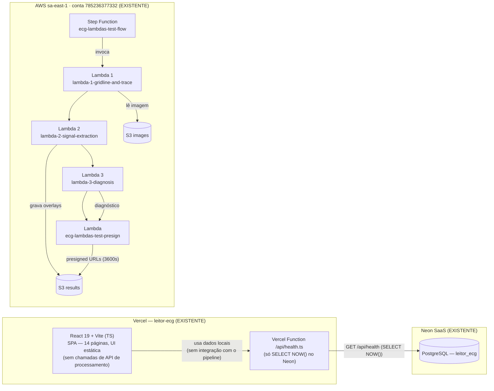
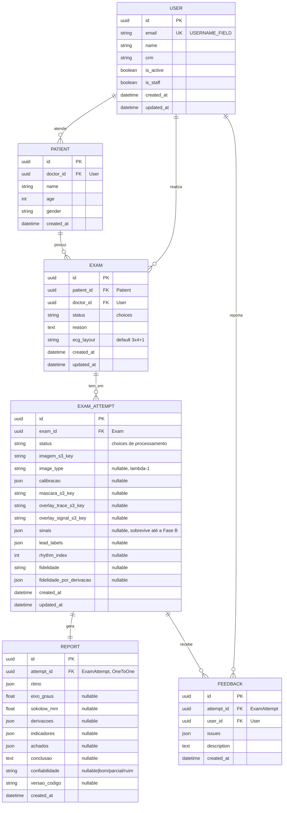
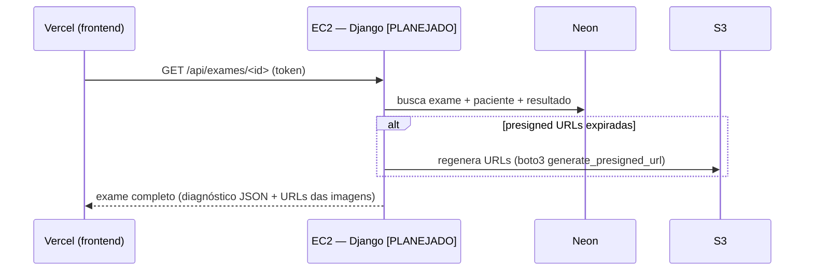
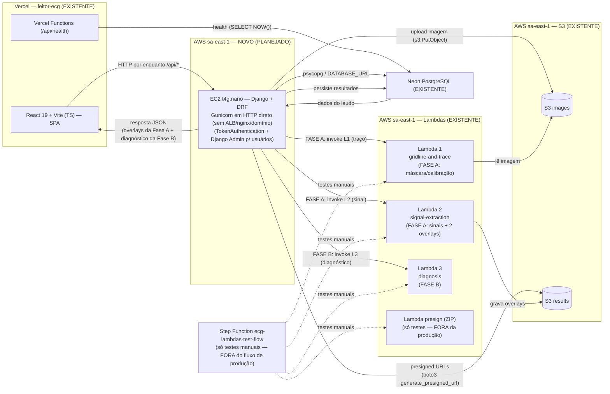

# ARCHITECTURE — Projeto ECG

Documento de arquitetura do ecossistema `projeto-ecg`, com duas visões:

1. **Arquitetura Atual** — o que existe hoje (deployado/funcional).
2. **Arquitetura Alvo (Completa)** — o plano proposto (ainda NÃO implementado),
   incorporando um backend Django em EC2 como camada de API/orquestração.

> Baseado nos arquivos reais: `ecg-lambdas/infra/terraform/main.tf`,
> `ecg-lambdas/infra/terraform/modules/*`, `ecg-lambdas/lambdas/*/handler.py`,
> `ecg-lambdas/.claude/deploy.md`, e o frontend em `leitor-ecg/`.
> Legenda: **[EXISTENTE]** = já deployado · **[PLANEJADO]** = proposto, não implementado.

---

## 1. Arquitetura Atual

### 1.1 Visão geral

Hoje existem **duas metades independentes**:

- **leitor-ecg** — frontend React + Vite em TypeScript (SPA), deployado na
  **Vercel**. É um protótipo de UI: as páginas navegam entre si e exibem dados
  locais/hardcoded; **não chama nenhuma API de processamento**. Há apenas um
  endpoint Vercel `api/health.ts` que roda um `SELECT NOW()` no **Neon** usando
  `@neondatabase/serverless`.
- **ecg-lambdas** — pipeline serverless de processamento de imagem de ECG na
  AWS (profile `trustedlake`, região `sa-east-1`, conta `785236377332`):
  - 3 Lambdas em container Docker (ECR): extração de traço/grade, extração de
    sinal, diagnóstico.
  - 1 Lambda ZIP de presign de URLs do S3 (`ecg-lambdas-test-presign`).
  - 1 **Step Function** `ecg-lambdas-test-flow` orquestrando
    lambda1 → lambda2 → lambda3 → presign.
  - 2 buckets S3 (`images` e `results`) com versionamento.
  - IAM dedicado (roles por lambda + role do Step Function). IaC Terraform com
    backend S3 `ecg-lambdas-terraform-state`.

O **Postgres (Neon) já existe** e é externo à AWS — não faz parte do código dos
repos. Não há backend próprio, nem EC2, nem API pública consumida pelo
frontend hoje.

### 1.2 Diagrama Mermaid — arquitetura atual



> Fluxo atual de processamento: um payload externo
> `{exame_id, imagem_s3_key, ecg_layout, sexo_feminino}` (visto em
> `test-payload.json`) dispara o Step Function manualmente, e o resultado
> final (presigned URLs das imagens + diagnóstico JSON) é devolvido apenas a
> quem invocou a execução. **Nada disso está ligado ao frontend hoje.**

### 1.3 Detalhe do pipeline de processamento

| Etapa | O que faz (código) | Entradas chave | Saídas / artefatos no S3 |
|---|---|---|---|
| **lambda1-gridline-and-trace** (Docker, timeout 120s, mem 1024) | Baixa imagem do bucket `images`, classifica tipo (`classify_ecg_image`), remove artefatos coloridos, encontra traço+grade por tipo, estima calibração | `exame_id`, `imagem_s3_key` | Grava `results/<id>/trace_mask.npz`; retorna `image_type, ecg_colors, mascara_traco_s3_key, imagem_original_s3_key, calibracao` |
| **lambda2-signal-extraction** (Docker, timeout 300s, mem 1024) | Corta painéis (`find_trace_bands`), remove componentes pequenos, overlay do traço (PNG), converte pontos da máscara em **sinais** (`panel_to_signal`), overlay do sinal (PNG), avalia fidelidade | máscara do S3, imagem original, `calibracao`, `ecg_layout` (hoje só `3x4+1` → `4x4`) | Grava `results/<id>/overlay_trace.png` e `overlay_signal.png`; retorna `sinais[] (amostras por lead)`, `lead_labels`, `rhythm_index`, `paineis[]`, `ecg_pintado_*_s3_key`, `fidelidade`, `fidelidade_por_derivacao`, `calibracao` |
| **lambda3-diagnosis** (Docker, timeout 120s, mem 512) | Computa medidas (`measure_ecg`), indicadores (`compute_indicators`) e interpretação (`interpret`) a partir dos sinais | `sinais`, `lead_labels`, `rhythm_index`, `calibracao`, `fidelidade`, `sexo_feminino` | Retorna `ritmo, eixo_graus, sokolow_mm, derivacoes, indicadores, achados, conclusao, confiabilidade, versao_codigo` |
| **lambda_test_presign** (Zip python3.12, timeout 30s, mem 128) | Gera presigned URLs (expiração 3600s) para as 3 imagens (original, overlay traço, overlay sinal) | `exame_id`, dict `images` com `{bucket, key}` por nome, `diagnostico` | Retorna `{exame_id, imagem_original_url, ecg_pintado_traco_url, ecg_pintado_sinal_url, diagnostico}` |
| **Step Function `ecg-lambdas-test-flow`** | `GridlineAndTrace → SignalExtraction → Diagnosis → PresignAndSummarize`; encadeia os Payloads entre etapas | input inicial `{exame_id, imagem_s3_key, ecg_layout, sexo_feminino}` | Output final com presigned URLs + diagnóstico |

---

## 2. Arquitetura Alvo (Completa)

### 2.1 Objetivo

Acrescentar uma **camada de backend Django** que:

- Seja a **única API consumida pelo frontend** (autenticação, regras de
  negócio, persistência de pacientes/exames/laudos no **Neon**).
- **Orquestre o pipeline existente de Lambdas** a partir do Django, salvando os
  resultados (S3 keys, sinais, diagnóstico) no Postgres junto ao exame.
- Disponibilize ao frontend o laudo pronto: dados do diagnóstico do banco +
  presigned URLs das imagens geradas.

### 2.2 Componente novo: backend Django

| Item | Proposta |
|---|---|
| Stack | Django + Django REST Framework, servido com Gunicorn (ASGI/uvicorn se necessário) |
| Onde roda | **EC2 `t4g.nano`** (ARM Graviton, 2 vCPU burst, 0.5 GiB RAM) na conta `trustedlake`, região `sa-east-1` |
| Entrada | **HTTP puro** (Gunicorn respondendo direto, sem ALB, sem nginx, sem domínio). Custo do IPv4 público é inevitável enquanto a API precisar ser pública (ver 2.5) |
| Banco | **Neon** (externo à AWS) via `DATABASE_URL` + psycopg |
| AWS SDK | `boto3` com credenciais via **IAM role da instância** (nunca access keys no código) |
| Orquestração | **Invocação síncrona direta** das Lambdas em **2 fases** (`InvocationType='RequestResponse'`): **Fase A** = lambda-1 + lambda-2 em sequência (sem gate entre elas), devolve os overlays ao frontend; **Fase B** = lambda-3, após aprovação do usuário — SEM Step Function no fluxo de produção |
| Autenticação | **DRF TokenAuthentication** (token opaco no banco, header `Authorization: Token ...`) + **User customizado** (`USERNAME_FIELD = 'email'`) desde a primeira migration; gestão de usuários via **Django Admin** (`is_staff`) |

**2.2.1 Schema de dados (DECIDIDO)**

O `docs/er-diagram.md` do leitor-ecg está **desatualizado** e não é mais a
referência. O schema abaixo resolve especificamente a necessidade de manter
**histórico de reprocessamento sem sobrescrever dados** (importante para
treinar/melhorar o algoritmo de diagnóstico no futuro):



> **Exam** é o "encontro clínico" (paciente + médico + motivo) — fica leve e
> **nunca guarda dado de processamento diretamente**. **ExamAttempt** guarda
> cada **tentativa** de processamento como linha **imutável** (reprocessar =
> linha nova). **Report** é o resultado da lambda-3, 1:1 com a tentativa que o
> gerou. **Feedback** permite crítica do médico sobre uma tentativa específica.
> **Subscriptions fica fora do MVP** — o model não existe.

> **Autenticação / login (DECIDIDO)**: o **login do médico é uma tela própria,
> simples, no frontend** (email + senha → POST → token opaco DRF). **Não é** o
> Django Admin. O Django Admin continua existindo **apenas para o dono do
> sistema** gerenciar quais contas de médico existem (`is_staff`) — os médicos
> nunca acessam `/admin`.

**2.2.2 Por que invocação síncrona direta (e não a Step Function)?**

**Decisão tomada**: o Django invoca cada Lambda **individualmente e de forma
síncrona** (`boto3.invoke` com `InvocationType='RequestResponse'`), organizadas
em **2 fases**, com um único gate de aprovação do usuário entre elas:

- **Fase A — traço + sinal (lambda-1 e lambda-2 em sequência, SEM gate entre
  elas)**: o usuário faz upload da imagem → Django cria o exame e chama
  **lambda-1 (gridline-and-trace)**; na sequência, sem nenhuma aprovação no
  meio, chama **lambda-2 (signal-extraction)** usando a saída de lambda-1. Ao
  final das duas, o Django devolve ao frontend **os dois overlays juntos**
  (`overlay_trace.png` e `overlay_signal.png`, como URLs presigned) **+ a
  fidelidade da extração** para **revisão visual única**.
- **Gate**: o usuário confere os dois overlays e clica em **"Aprovar e
  continuar"**.
- **Fase B — diagnóstico**: só então o Django chama **lambda-3 (diagnosis)**,
  que devolve o diagnóstico final (`ritmo, eixo_graus, sokolow_mm, derivacoes,
  indicadores, achados, conclusao, ...`). Persistência no Neon; presigned URLs
  das imagens disponibilizadas ao frontend.

**Por que 2 fases e não 3?** Por uma restrição técnica observada no código real
das lambdas (`lambdas/lambda_1_gridline_and_trace/handler.py`,
`lambda_2_signal_extraction/handler.py`, `lambda_3_diagnosis/handler.py`):

1. **lambda-1 grava apenas `results/<exame_id>/trace_mask.npz`** — uma máscara
   numpy bruta (`np.savez_compressed`), **não uma imagem visualizável**. Sozinha
   ela **não produz nada que dê para mostrar ao usuário** — não há overlay
   ainda.
2. **Quem gera as imagens visuais é a lambda-2**: `overlay_trace.png` (linhas
   do traçado sobre o ECG original — exatamente o que o usuário quer conferir)
   e `overlay_signal.png` (o sinal extraído sobre o ECG original). Não existe
   artefato visual antes dela.
3. **lambda-3 não toca no S3**: recebe os sinais já no payload da invocação
   (vindos da lambda-2) e devolve apenas o JSON do diagnóstico. Não há nada a
   revisar nem artefato a persistir além do próprio JSON.

Logo, um gate de aprovação entre lambda-1 e lambda-2 **não teria o que
mostrar** (exibir a máscara numpy bruta seria inviável para o usuário). O
primeiro ponto visualmente revisável só existe depois da lambda-2 — por isso as
duas rodam juntas na **Fase A**, e a única aprovação do usuário fica entre o
par (A) e o diagnóstico (B).

Motivação: **poder conferir dentro do app se o traçado e o sinal extraídos
estão corretos antes de rodar o diagnóstico** — em vez de só ver o resultado no
fim de um pipeline assíncrono opaco. Se o traçado ou o sinal vierem errados, o
usuário descobre após a Fase A e o fluxo para aí (pode reprocessar) antes de
gastar o custo/tempo do diagnóstico.

Essa decisão **não reutiliza a Step Function `ecg-lambdas-test-flow`** — ela
continua existindo **apenas para testes manuais/debug** do pipeline (via
`test-payload.json`), fora do fluxo de produção.

**Ponto técnico obrigatório**: a **lambda-2 tem `timeout` de 300s** e roda
**dentro da Fase A** (logo o request da Fase A pode segurar a requisição por
até ~5 min). Por isso:

- O **timeout do worker do Gunicorn** deve ser configurado **acima de 300s**
  (ex.: `--timeout 360` ou maior), e o `proxy_read_timeout` no nginx — quando
  existir — deve acompanhar.
- O **frontend precisa de estado de "processando"** (spinner/aviso) durante a
  chamada da Fase A, para o usuário saber que o pedido está em andamento.

### 2.3 Fluxo alvo

**A) Novo exame — processamento em 2 fases (A: lambda-1+lambda-2, B: lambda-3):**

```mermaid
sequenceDiagram
    participant U as Usuário (leitor-ecg)
    participant V as Vercel (frontend)
    participant D as EC2 t4g.nano — Django [PLANEJADO]
    participant N as Neon
    participant G as S3 (images/results)
    participant L1 as Lambda-1 gridline-and-trace
    participant L2 as Lambda-2 signal-extraction
    participant L3 as Lambda-3 diagnosis

    U->>V: envia imagem + dados do paciente
    V->>D: POST /api/exames (token)
    rect rgb(235, 245, 255)
    Note over D,L2: FASE A — lambda-1 + lambda-2 em sequência, sem gate entre elas
    D->>N: cria exame (status=criado) + persiste paciente
    D->>G: upload imagem → s3://images/<exame_id>/...
    D->>L1: invoke RequestResponse(exame_id, imagem_s3_key)
    L1-->>D: image_type, calibracao, mascara_traco_s3_key
    D->>L2: invoke RequestResponse(mascara, imagem, calibracao, ecg_layout)
    Note over D,L2: chamada síncrona até ~300s (timeout da lambda-2)<br/>Gunicorn --timeout acima; frontend "processando"
    L2-->>D: sinais[], fidelidade, ecg_pintado_*_s3_key
    D->>N: salva sinais/fidelidade (status=overlays_gerados)
    D->>G: presigned URLs dos 2 overlays (trace + signal)
    D-->>V: 200 {overlay_trace_url, overlay_signal_url, fidelidade, image_type}
    V-->>U: usuário revisa os DOIS overlays + fidelidade
    end

    U->>V: clica "Aprovar e continuar" (ou rejeita/reinicia)
    V->>D: POST /api/exames/<id>/aprovar-fase-a
    rect rgb(255, 245, 230)
        Note over D,L3: FASE B — diagnóstico
        D->>L3: invoke RequestResponse(sinais, lead_labels, calibracao, sexo_feminino)
        L3-->>D: ritmo, eixo_graus, sokolow_mm, derivacoes, achados, conclusao
        D->>N: persiste diagnóstico (status=concluido)
        D-->>V: 200 {diagnóstico completo}
    end
    V->>U: exibe laudo final (diagnóstico + imagens via URL presigned)
```

> **Nota**: nomes de endpoints (`POST /api/exames` — Fase A embutida, `POST
> /api/exames/<id>/aprovar-fase-a`) e de status (`criado`, `overlays_gerados`,
> `concluido`) são propostos neste documento e **devem ser validados/ajustados**
> ao desenhar a API real do Django.

**B) Consulta de um exame/laudo já concluído (síncrona):**



### 2.4 Diagrama Mermaid — arquitetura alvo (completa)



### 2.5 Segurança, autenticação e custos (alvo)

- **IAM**: role EC2 com política mínima (`lambda:InvokeFunction` nas 3 lambdas,
  `s3:PutObject` em `images`, `s3:GetObject` em ambos os buckets). Sem chaves de
  acesso em código.
- **Segurança de rede**: **HTTP puro por enquanto** — Gunicorn respondendo
  direto, sem nginx e sem domínio. Não há domínio disponível para emitir um
  certificado TLS confiável (Let's Encrypt exige domínio, não funciona com IP
  nu) e não há previsão de comprar um domínio no curto prazo.
- **Custo inevitável — IPv4 público**: desde fev/2024 a AWS cobra por qualquer
  IPv4 público em instância EC2 (IP público automático **ou** Elastic IP),
  ~US$0,005/hora (~US$3,60–4,00/mês). **Não há como evitar esse custo enquanto
  a API precisar ser pública**, com ou sem Elastic IP formal. É o único custo
  adicional real e inevitável além do preço da própria `t4g.nano`.
- **Quando houver domínio no futuro**: caminho natural é **nginx + certbot
  (gratuito)** na própria instância — **sem ALB**. Anotado como passo futuro,
  nada a fazer agora.
- **Secrets**: `DATABASE_URL` do Neon via SSM Parameter Store (tipo
  `SecureString`) ou Secrets Manager; nunca em variável de ambiente de build.
- **Autenticação (DECIDIDO)**: **DRF TokenAuthentication** — token opaco por
  usuário, salvo no banco, enviado no header `Authorization: Token ...`. Não é
  JWT. Motivo: mais simples e evita problemas de cookie cross-domain entre a
  Vercel e a EC2 (que exigiriam HTTPS funcional). Token por header não depende
  de TLS confiável para funcionar na prática do MVP.
- **Login do médico = tela própria no frontend**: `POST /api/auth/login/` com
  email + senha devolve `{token, user}`; o médico nunca acessa o Django Admin.
  **Django Admin existe somente para o dono do sistema** gerenciar quais contas
  de médico existem (`is_staff`), volume baixo.
- **User model customizado desde a primeira migration** com
  `USERNAME_FIELD = 'email'` (sem usar o `username` padrão). **Importante**:
  fazer **já no início** do projeto Django — trocar o User depois de já
  existirem migrations é muito mais custoso.
- **Gestão de usuários via `django.contrib.admin`** protegido por `is_staff`,
  sem tela custom de CRUD de usuários.
- **Custo computacional**: `t4g.nano` é o menor tamanho; Django + Gunicorn
  cabem, mas com folga pequena de RAM (0.5 GiB) — se a aplicação crescer,
  subir para `t4g.micro`/`t4g.small`.

---

## 3. Tabela-resumo dos componentes

| Componente | O que é | Onde roda | Status | O que falta no alvo |
|---|---|---|---|---|
| **leitor-ecg** | Frontend React 19 + Vite TS (14 páginas) | Vercel | **[EXISTENTE]** | Conectar páginas ao backend Django; fluxo de auth; consumir resultados reais |
| **Vercel Functions /api** | Healthcheck do Neon | Vercel | **[EXISTENTE]** | Manter apenas health (banco passa a ser acessado pelo Django) |
| **Neon PostgreSQL** | Banco de dados (usuários, pacientes, exames, laudos) | Neon SaaS | **[EXISTENTE]** | Aplicar o novo schema (ver 2.2.1) — o `docs/er-diagram.md` antigo está desatualizado e deixou de ser referência |
| **Lambdas 1–3 (container ECR)** | Pipeline de processamento de ECG | AWS sa-east-1 | **[EXISTENTE]** | Nenhuma — apenas serem invocadas **individualmente** pelo Django (`InvocationType='RequestResponse'`) em 2 fases (1+2 na Fase A, 3 na Fase B) |
| **Lambda presign (ZIP)** | Presigned URLs (3600s) | AWS sa-east-1 | **[EXISTENTE]** | **FORA do fluxo de produção** — manter apenas para testes manuais/debug; em produção o **próprio Django gera as URLs** (`boto3.generate_presigned_url`) |
| **Step Function test-flow** | Orquestração L1→L2→L3→presign | AWS sa-east-1 | **[EXISTENTE]** | **Fora do fluxo de produção** — manter apenas para testes manuais/debug; não renomear para produção |
| **S3 images / results** | Imagens de entrada e overlays gerados | AWS sa-east-1 | **[EXISTENTE]** | Bucket policy para a role da EC2 (upload de imagem) |
| **Terraform ecg-lambdas** | IaC atual | `ecg-lambdas/infra/terraform` | **[EXISTENTE]** | Estender com VPC/subnet/EC2 (sem ALB por decisão) ou novo módulo |
| **Backend Django** | API REST + auth + orquestração do pipeline | **EC2 t4g.nano** | **[PLANEJADO]** | Criar projeto, models, DRF, invocação síncrona das lambdas, endpoints |
| **EC2 t4g.nano + tooling** | Host do Django (systemd/container) | AWS sa-east-1 | **[PLANEJADO]** | Terraform: VPC, SG, IAM role, deploy do app |
| **nginx + certbot** | Entrada HTTPS (futuro, só quando houver domínio) | AWS sa-east-1 | **[PLANEJADO + FUTURO]** | Nada agora — só quando existir domínio (ver 2.5) |

---

## 4. Decisões e premissas (DECIDIDO = validado pelo usuário · a validar = pendente)

| # | Decisão/premissa assumida | Status | Decisão / proposta registrada |
|---|---|---|---|
| 1 | **Orquestração**: como o Django chama as Lambdas | **DECIDIDO** | **2 fases, não 3**: **Fase A** = lambda-1 + lambda-2 invocadas em sequência no mesmo request (`RequestResponse`), sem gate entre elas, devolvendo os 2 overlays + fidelidade; **Fase B** = lambda-3 após aprovação do usuário. Motivo técnico: lambda-1 sozinha **não produz overlay visual** (só a máscara `.npz`); os overlays só existem após a lambda-2; lambda-3 não toca S3 (**DECIDIDO**, cf. código real). **Sem Step Function** no fluxo de produção — a SFN `ecg-lambdas-test-flow` fica só para testes manuais/debug |
| 2 | **Autenticação** | **DECIDIDO** | User customizado com `USERNAME_FIELD='email'` desde a primeira migration + **DRF TokenAuthentication** (token opaco no banco, header `Authorization: Token ...`) — sem JWT. **Login do médico = tela própria no frontend** (email + senha → token) — **não é o Django Admin**. O Admin continua existindo **apenas para o dono do sistema** gerenciar contas de médico (`is_staff`) |
| 3 | **Schema de dados** | **DECIDIDO** | Seguir o **novo schema** (ver diagrama em 2.2.1): **User** custom (email como USERNAME_FIELD, name/crm), **Patient**, **Exam** (encontro clínico leve, sem dados de processamento), **ExamAttempt** (linha **imutável** por tentativa — histórico de reprocessamento sem sobrescrever, essencial pra treinar/melhorar o algoritmo no futuro), **Report** (1:1 com a tentativa, resultado da lambda-3) e **Feedback** (críticas do médico sobre uma tentativa). **Subscriptions NÃO entra no MVP** — não criar o model. O `docs/er-diagram.md` antigo do leitor-ecg está desatualizado e deixa de ser referência |
| 4 | **Presign URLs**: manter lambda presign vs. gerar no Django | **DECIDIDO** | **O Django gera as URLs direto via `boto3.generate_presigned_url`** (a lambda presign exige `event['images']` + `diagnostico` já pronto — incompatível com a Fase A, onde overlays são exibidos antes de existir diagnóstico). A lambda presign fica **fora do fluxo de produção** — só testes/debug. Expiração configurável no Django |
| 5 | **Layout do ECG**: pipeline só suporta `3x4+1` | **DECIDIDO** | Só **`3x4+1`** por enquanto — `ecg_layout` no Exam tem default/único valor `"3x4+1"` no MVP; outros layouts ficam para depois |
| 6 | **`sexo_feminino`**: necessário para lambda3 | **DECIDIDO** | Fica **fora por enquanto** — `compute_indicators` (`ecg-lambdas/functions/diagnosis/indicators.py:415`) já aceita `sexo_feminino=None` sem quebrar (só deixa de calcular o critério de Cornell). Sem campo no schema nesta fase |
| 7 | **Entrada HTTPS da EC2** | **DECIDIDO** | **Sem ALB, sem domínio por enquanto** — HTTP puro (Gunicorn direto). IPv4 público na instância será cobrado (~US$3,60–4/mês, inevitável). Quando houver domínio: **nginx + certbot** na própria instância, sem ALB |
| 8 | **Notificação de fim do pipeline** | **DECIDIDO** | Não aplicável — sem pipeline assíncrono. As chamadas síncronas devolvem o resultado inline na própria resposta; o frontend usa estado "processando" durante a Fase A (que inclui a lambda-2 com timeout de 300s) |
| 9 | **EC2 t4g.nano** | **DECIDIDO** | Segue com `t4g.nano` — será testado na prática; só subir para `t4g.micro`/`t4g.small` se a prática mostrar que falta recurso |
| 10 | **Upload de imagem**: quem faz o upload | **DECIDIDO** | **Presigned PUT direto do frontend pro S3** — o upload **não passa pelo Django**. Presigned URLs de leitura **nunca são persistidas** no banco: só a S3 key é persistida, e a URL é gerada sob demanda a cada resposta da API |

---

## 5. Inconsistências e lacunas encontradas

1. **`leitor-ecg/infrastructure/` era obsoleto e enganoso (REMOVIDO).** Os READMEs
   de `infrastructure/terraform`, `infrastructure/database` e
   `infrastructure/scripts` descreviam **GCP** (Cloud Run, Cloud SQL, GCS,
   `gcloud`), mas isso nunca existiu — a realidade é Vercel + Neon. A pasta foi
   **removida**; o schema de dados migrou para o contexto do backend Django
   (ver 2.2.1).
2. **Frontend não está conectado ao pipeline.** Nenhuma página faz `fetch`
   para qualquer API; o único acesso ao Neon é `api/health.ts`. O fluxo
   "Novo ECG" navega entre telas com dados locais.
3. **Step Function é de teste — e continua como teste.** Nome e commentário no
   código (`main.tf:166` — "So para teste manual, nao produtivo") indicam que o
   fluxo não é para produção. **Decisão**: manter `ecg-lambdas-test-flow`
   **apenas para testes manuais/debug** do pipeline (via `test-payload.json`);
   o fluxo de produção passa a invocar as lambdas individualmente a partir do
   Django — a Step Function não é renomeada nem usada em produção.
4. **Presign hardcoded em 3600s** e com endpoint regional
   (`s3.sa-east-1.amazonaws.com`). Para o MVP pode bastar, mas URLs longas
   para o usuário final podem precisar de regeneração pelo Django.
5. **Único layout suportado** no pipeline (`3x4+1` → tipo `4x4`). O frontend
   tem tela de configuração de ECG, então é preciso alinhar quais layouts são
   permitidos no fluxo de produção antes de fechar o schema de exame.
6. **Deploy das lambdas é manual** (scripts/Makefile + terraform manual, sem
   CI/CD). Para o alvo, avaliar pipeline de CI (GitHub Actions) para
   build/push/apply — fora do escopo deste planejamento.
